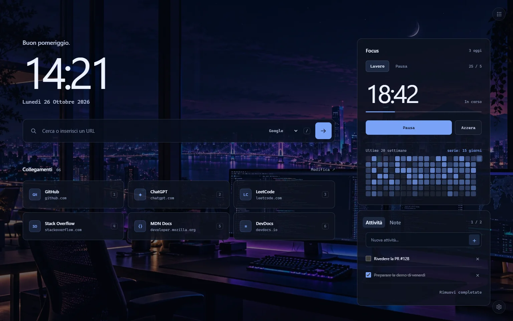
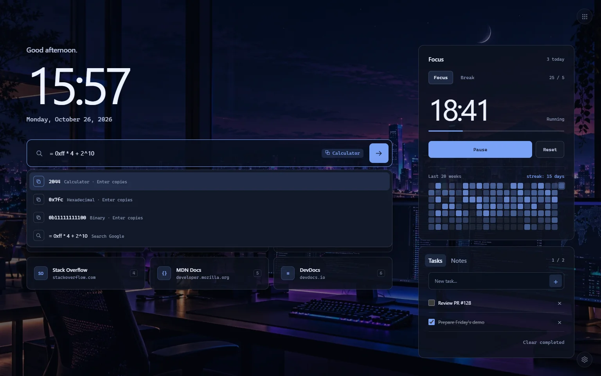
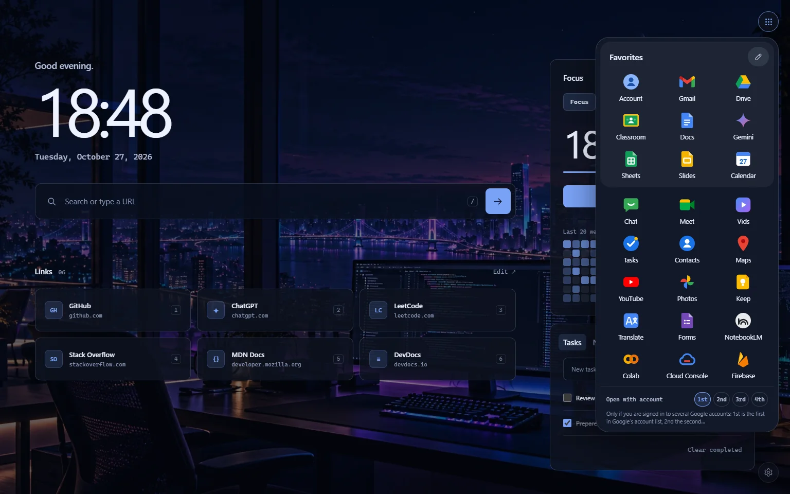
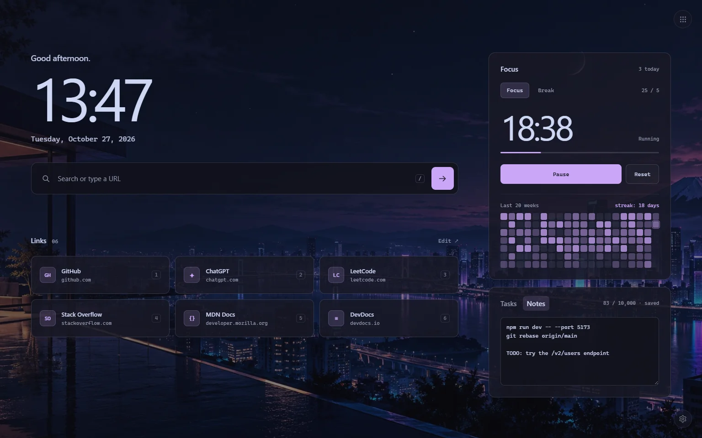

<p align="center">
  
</p>

<h1 align="center">Atrio</h1>

<p align="center">
  A keyboard-first new tab for developers. Fast, local, zero dependencies.
</p>

<p align="center">
  <a href="https://github.com/gurmilans-dev/atrio/actions/workflows/ci.yml"></a>
  
  
  <a href="LICENSE"></a>
</p>



Atrio replaces Chrome's new tab page with a calm place to start from: a search box that understands code and
dev URLs, a command palette, quick links, a focus timer with a GitHub-style activity heatmap, tasks and notes, and a
Google apps launcher. It is plain HTML, CSS and JavaScript modules: no framework, no build step, no tracking, and no
network requests unless you turn on online search suggestions.

> The interface is in English and Italian. It follows the browser language; you can also pick one in
> **Settings → General**.

## Features

- **Search that knows code from URLs.** `console.log`, `next.js` or `README.md` are searched, not opened as domains.
  `localhost:5173`, LAN IPs, `[::1]` and `*.test` open over `http://`. Prefixes search a site directly (`yt lofi`,
  `npm zod`; also `gh`, `mdn`, `so`, `py`, `ciu`, `dd`) and, typed alone, open it (`yt` → YouTube). Add your own
  in Settings with `%s` where the text goes: `jira 123` → your Jira ticket, `pr 42` → a pull request of your repo.
  `chrome://` pages work, `Shift + Enter` always searches.
- **Recent searches** come back as you type, and on an empty box, like in the address bar; `Shift + Delete`
  forgets one. They stay in your browser and can be turned off.
- **Command palette.** While you type, matching links, Google apps and commands appear under the box. `>` (or
  `Ctrl + Shift + P`) lists every command; `+ some text` adds a task without leaving the search.
- **Developer tools in the search box**, all local; `Enter` copies the result:
  - calculator: `= sqrt(144) * 2^10`, `0xff + 0b11`, or just `1024*3`, with hex and binary for integers;
  - timestamps both ways: `ts`, `ts 1730000000`, `ts 2026-10-26 14:00`;
  - `uuid` (or `uuid 5`), `pw` / `pw 32` for random passwords;
  - `b64` / `b64d` and `url` / `urld` to encode and decode text;
  - `jwt <token>`, or just paste a token: payload, header, expiry and issue dates (the signature is not checked);
  - `sha256 <text>` for a hex digest;
  - `json <text>`, or just paste an object or array: says whether it is valid (and where it breaks if not), copies it
    formatted or minified;
  - `case user profile id` gives `userProfileId`, `UserProfileId`, `user_profile_id`, `user-profile-id`,
    `USER_PROFILE_ID` and a URL slug, from text written in any of those styles;
  - `http 429` explains a status code; `http 40` lists 400–409, `http too many` searches them;
  - `cron */15 9-18 * * 1-5` (or just the expression, or `@daily`) in words, with the next three runs;
  - colors: `#7aa2f7`, `rgb(…)` or `hsl(…)` converted to the other formats, with a swatch.
- **Focus timer.** 25/5, 50/10 or your own durations, a system notification when a session ends (even with no tab open), the
  countdown in the tab title, a 20-week heatmap and your current streak.
- **Tasks and notes.** Undo for deletions; a plain-text scratchpad that saves while you type.
- **Google apps launcher.** 24 apps with editable favorites (drag, or `Ctrl + ←/→`), and a switch for people signed in
  to several Google accounts.
- **Make it yours.** Six themes: three dark ones, a light one, one that takes its accent color from your wallpaper,
  one with any color you pick (adjusted if needed to stay readable). Up to eight wallpapers of your own (downscaled to
  WebP on your machine), rotating every day or with every new tab; dim and blur. Hide the parts you do not use
  (greeting, clock, date, links, focus panel, heatmap, tasks): with both side panels off the page becomes one calm,
  centered column. A 24- or 12-hour clock, with or without seconds. Optional mouse effects (link borders that light
  up near the cursor, a slight lift, wallpaper parallax), off by default.
- **Keyboard everywhere** and **backups** to a JSON file, your wallpapers included.

| Developer tools        | Google apps         | Mocha theme and notes |
| ---------------------- | ------------------- | --------------------- |
|  |  |   |

## Install

1. Clone or download this repository and keep the folder somewhere permanent.
2. Open `chrome://extensions`, turn on **Developer mode**, click **Load unpacked** and pick the folder.
3. Open a new tab. Chrome puts the cursor in the address bar: click the page to use the shortcuts.

Chrome 117 or later. Edge works too.

<details>
<summary>Keep the same extension ID when moving the folder</summary>

Chrome derives the ID of an unpacked extension from its folder path, and the ID owns the saved data. To pin it:
export a backup (**Settings → Data → Export backup**), run `npm run apply-key`, remove and load the extension
again, then import the backup. From then on the ID no longer depends on where the folder lives.

</details>

## Keyboard shortcuts

| Key                       | Action                                   |
| ------------------------- | ---------------------------------------- |
| `/` or `Ctrl + K`         | Focus the search                         |
| `>` or `Ctrl + Shift + P` | Command palette                          |
| `↑` `↓` `Enter` `Esc`     | Move through suggestions, run, close     |
| `Shift + Enter`           | Search even if the text looks like a URL |
| `Shift + Delete`          | Forget the highlighted recent search     |
| `1` … `9`                 | Open quick link 1–9                      |
| `G`                       | Google apps                              |
| `T` / `N`                 | New task / notes                         |
| `P`                       | Start or pause the timer                 |
| `S` / `?`                 | Settings / shortcut list                 |

## Privacy and permissions

Everything stays in the browser (`localStorage` and IndexedDB). Atrio makes no network requests of its own: it only
navigates when you search or open a link. The one exception is opt-in: with **online search suggestions** turned on
(Settings → General, off by default), what you type in the search box is sent to Google or DuckDuckGo, whichever is
your engine, without cookies, as Chrome's address bar does.

| Permission                                              | Why                                                                    |
| ------------------------------------------------------- | ---------------------------------------------------------------------- |
| `alarms`                                                | Schedule the end of a focus session, even when no tab is open          |
| `notifications`                                         | Tell you when the session is over                                      |
| `favicon`                                               | Show site icons for quick links from Chrome's local cache (no network) |
| Optional: `suggestqueries.google.com`, `duckduckgo.com` | Online search suggestions, asked only when you turn them on            |

## How it works

- **No flash on open.** A tiny blocking script (`js/boot.js`) applies theme, wallpaper, dim and blur before the first
  paint; the ES modules load after.
- **One store, many tabs.** All state lives in one validated object (`js/state.js`). Every open new tab listens to the
  `storage` event, so tabs never overwrite each other with stale data. A corrupted save is backed up, not discarded.
- **A timer that survives throttling.** Sessions store an absolute end time; ticks align to the displayed second while
  visible and drop to once a minute when hidden. The service worker only wakes up for the end-of-session alarm.
- **Idle means idle.** Nothing runs while the page is still: measured at about 0.03% of one CPU core (around 0.15%
  with the clock's seconds shown, one text update per second). With the mouse
  effects off (the default) no pointer listener exists and hover states change instantly, so moving the mouse costs
  about what the browser itself needs (~4% of a core in headless Chrome, versus ~17% with the effects on). When on,
  the spotlight restyles one small layer per element (custom properties inherit, so setting them on a panel would
  restyle all its content), and everything switches off with `prefers-reduced-motion`.
- **Two languages without a framework.** Every text lives in `js/i18n.js`. The static ones are marked in the HTML
  with `data-i18n` attributes, and the page stays hidden for the moment it takes to fill them in. Dates, numbers and
  ordinals use `Intl` in the chosen language, and the end-of-session notification follows it too. A test checks that
  both languages have the same keys and placeholders.
- **Suggestions that do not get in the way.** They are requested after a 150 ms pause in typing, every keystroke
  cancels the previous request, answers are cached, and rows are never inserted while you are moving through the
  list. Offline, the box works as if they were off.
- **A calculator without `eval`.** The palette's math goes through a small recursive-descent parser: `eval` would be
  unsafe and is blocked by the extension's content security policy anyway.
- **Pure logic, tested.** Search resolution, state validation, timer, stats, color extraction and ranking are pure
  modules covered by `node --test`; a CDP-driven suite checks the real page in headless Chrome.

## Development

Requires Node.js 22+. There is nothing to install: the tools run through `npx`.

| Command               | What it does                                                       |
| --------------------- | ------------------------------------------------------------------ |
| `npm test`            | Unit tests (`node --test`)                                         |
| `npm run test:e2e`    | End-to-end checks in headless Chrome (set `CHROME_PATH` if needed) |
| `npm run lint`        | ESLint                                                             |
| `npm run format`      | Prettier                                                           |
| `npm run check`       | Unit tests, lint and formatting check (what CI runs)               |
| `npm run screenshots` | Regenerate the images in `docs/` with demo data                    |
| `npm run icons`       | Render the PNG icons from `assets/icons/icon.svg`                  |

To work on the UI without reloading the extension, serve the folder (e.g. `npx serve .`) and open `index.html`: the
page runs outside the extension too, just without notifications, site icons, online suggestions and `chrome://`
pages.

```
manifest.json        Manifest V3
index.html, style.css
background.js        service worker: end-of-session notifications
js/boot.js           blocking script applied before the first paint
js/main.js           entry point, cross-tab sync
js/config.js         themes, engines, prefixes, presets, limits
js/state.js          schema, validation, migrations
js/i18n.js           interface texts in English and Italian, formatters
js/search.js         text → URL, search or prefix
js/timer.js, js/stats.js, js/color.js, js/fuzzy.js   pure logic
js/google-apps.js    launcher catalog and icons
js/*.js              UI modules (links, tasks, notes, focus, apps, settings, effects…)
_locales/            extension description for the Chrome Web Store and chrome://extensions
tests/               unit tests; tests/e2e/ browser checks
scripts/             icons, screenshots, extension key
```

## License

[MIT](LICENSE). Atrio is not affiliated with Google. Google product names belong to their owners; the launcher icons
are simplified drawings made for this project.
